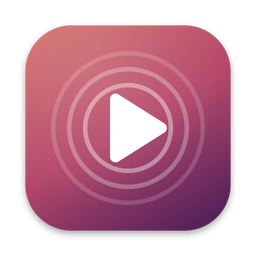
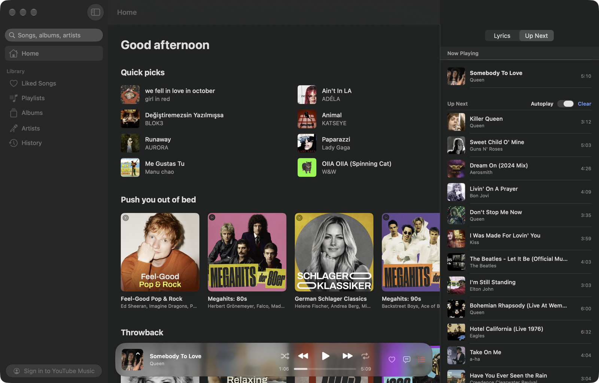
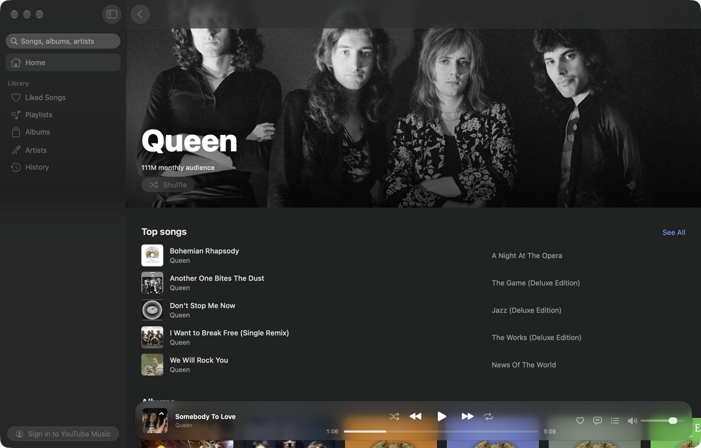

<p align="center">
  
</p>

<h1 align="center">Encore</h1>

<p align="center"><b>The better solution for YouTube Music on the Mac.</b><br>
A native macOS app for your YouTube Music library, built in SwiftUI.</p>

<p align="center"></p>

## Why

The YouTube Music website is a browser tab pretending to be an app. Encore is a real Mac app: a sidebar for your library, a player bar that stays out of the way, keyboard shortcuts that work, and music that keeps playing when you close the window.

## What you get

- **Home, search and suggestions** as you type, with songs, albums, artists and playlists.
- **Your library** after signing in: Liked Songs, playlists, albums, artists and history. Like songs and add them to playlists.
- **Album, playlist and artist pages** with full track lists, shuffle and radio.
- **Up Next queue** with shuffle, repeat and autoplay that keeps the music going.
- **Synced lyrics** that follow the song, with YouTube Music's own lyrics as a fallback.
- **Now Playing** view with large artwork.
- **Lives in the Dock.** Close the window and the music keeps playing. Click the Dock icon to bring it back, or right-click it for play, pause, skip and like.
- **macOS 26 design** with Liquid Glass.

<p align="center"></p>

## Install

1. Download `Encore.zip` from the [latest release](https://github.com/joogox/encore/releases/latest) and unzip it.
2. Move `Encore.app` to your Applications folder.
3. Open it. Encore is not notarized by Apple, so macOS stops it from opening. Go to **System Settings > Privacy & Security** and click **Open Anyway** next to the Encore message.

Encore needs macOS 26 or later.

## Sign in

Click **Sign in to YouTube Music** at the bottom of the sidebar and sign in on Google's own page. Encore works without an account too: you can browse, search and play, but your library stays empty.

## Keyboard shortcuts

| Action | Shortcut |
|---|---|
| Play or pause | Space |
| Next / previous track | ⌘→ / ⌘← |
| Volume up / down | ⌘↑ / ⌘↓ |
| Like | ⌘L |
| Shuffle / repeat | ⌥⌘S / ⌥⌘R |
| Lyrics / Up Next | ⌥⌘L / ⌥⌘U |
| Now Playing | ⇧⌘N |
| Home / Liked Songs / Playlists | ⌘1 / ⌘2 / ⌘3 |
| Back | ⌘[ |

## How it works

Encore plays music through YouTube Music's own web player, which runs hidden inside the app. Everything you see and touch is native SwiftUI. Because the player is YouTube's own, your account, your recommendations and your history work exactly as they do on the website. Without YouTube Music Premium, ads play as they do there.

Encore has no servers of its own. It talks to YouTube Music, and to [LRCLIB](https://lrclib.net) for synced lyrics. Your sign-in stays on your Mac. On YouTube's cookie prompt, Encore answers "reject non-essential" for you.

## Build from source

You need Xcode 26.

```bash
git clone https://github.com/joogox/encore.git
cd encore
open Encore.xcodeproj
```

Then press Run. The project is generated from `project.yml` with [XcodeGen](https://github.com/yonaskolb/XcodeGen); run `xcodegen generate` after adding or removing files.

## License

[MIT](LICENSE)

Encore is an independent project. It is not affiliated with, endorsed by or sponsored by Google or YouTube. YouTube Music is a trademark of Google LLC.
